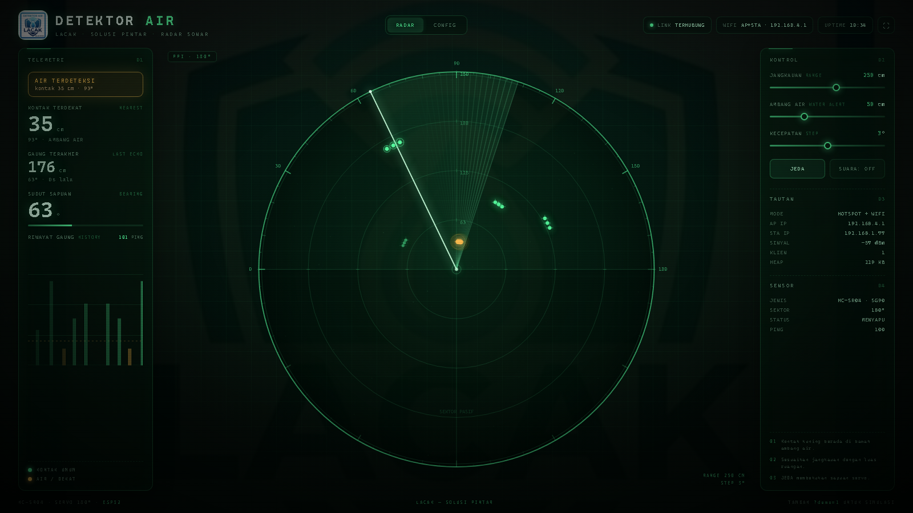
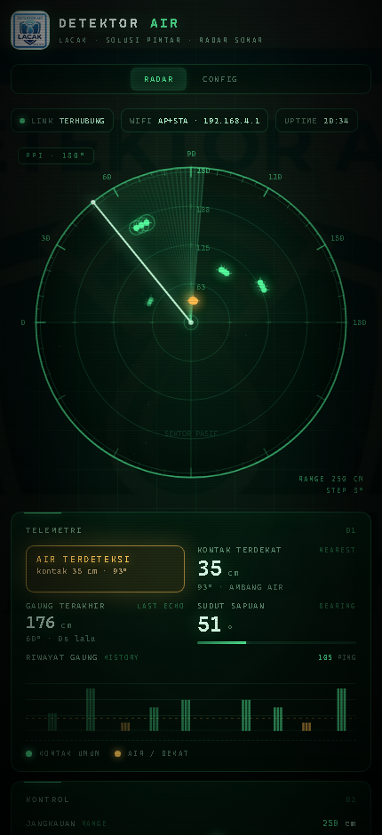
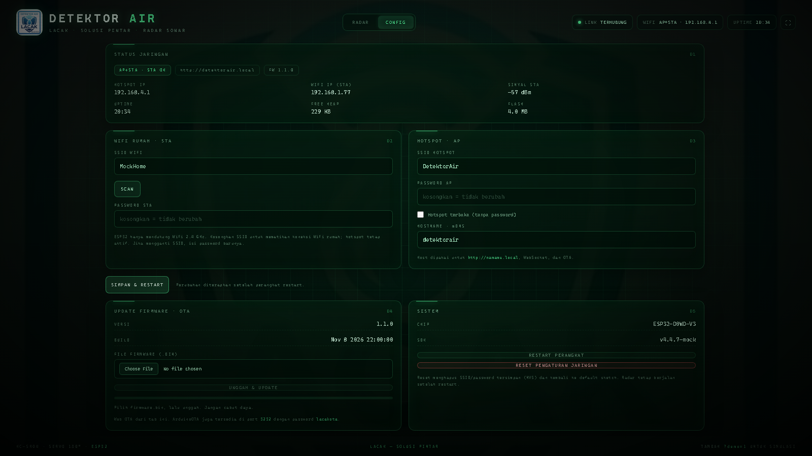

# DETEKTOR AIR LACAK

**ESP32 · HC-SR04 · SG90 · live sonar radar web UI**

A real 180° ultrasonic radar with a green PPI / sonar interface. The ESP32
sweeps an SG90 servo, takes an HC-SR04 distance reading at every angle, and
streams bearing + distance to the browser over WebSocket. Echoes appear at
their true angle and fade away like phosphor on a radar scope. Everything is
served by the ESP32 itself — no internet connection is required.

The LACAK artwork from `Background.jpeg` is used as the dimmed full-page
backdrop and header logo (served as `web/logo.jpg`).



<p align="center">
  
</p>

## Features

- Real 180° servo sweep with live HC-SR04 distance on every step
- Radar PPI scope with sweep wedge, range rings, bearing ticks and fading blips
- “AIR TERDETEKSI” water/contact alert with an adjustable threshold (10–150 cm)
- Live echo-history graph, nearest contact, last echo and ping counter
- Range (40–400 cm), scan speed (1–5°) and pause controls from the browser
- **AP + STA at the same time** — the hotspot stays available while the ESP32
  also joins a 2.4 GHz home WiFi network
- **CONFIG tab** — WiFi scan, STA/AP credentials, hostname and factory reset,
  saved in NVS and applied at boot
- **OTA updates** — web upload from the Config tab and ArduinoOTA on port 3232
- Automatic browser reconnect, full-screen mode, optional sonar ping sound
- Responsive layout for phone, tablet and desktop
- `?demo=1` simulation mode — preview the UI with no hardware
- Arduino IDE **and** PlatformIO project files included

## Project layout

```text
.
├─ platformio.ini              PlatformIO project (builds the same sketch)
├─ firmware/ESP32_Radar/
│  ├─ ESP32_Radar.ino          ESP32 firmware (Arduino sketch)
│  └─ web_assets.h             auto-generated embedded UI
├─ web/
│  ├─ index.html               editable radar UI (CSS + JS inline)
│  └─ logo.jpg                 background/logo image
├─ tools/build_assets.py       embeds web/ into web_assets.h
├─ docs/                       screenshots
└─ README.md
```

## Hardware

| Part | Notes |
|---|---|
| ESP32 DevKit (ESP32-D / WROOM-32) | 4 MB flash recommended |
| HC-SR04 ultrasonic sensor | **not waterproof** |
| SG90 / MG90S servo | 180° type |
| 5 V ≥ 1 A power supply | separate supply for the servo is strongly recommended |
| 1 kΩ + 2 kΩ resistors | voltage divider for the HC-SR04 ECHO pin |
| 470–1000 µF electrolytic capacitor | across the servo supply (avoids brownouts) |
| Jumper wires, servo bracket | mount the sensor on the servo horn |

### Wiring

```text
HC-SR04                                ESP32
  VCC ─────────────── 5V ───────────── 5V
  GND ─────────────── GND ──────────── GND
  TRIG ─────────────────────────────── GPIO 5
  ECHO ──[ 1 kΩ ]──┬────────────────── GPIO 18
                   │
                [ 2 kΩ ]
                   │
                  GND

SG90
  red    (+) ─────── +5V external (1 A), 470 µF to GND
  brown  (−) ─────── GND (common with ESP32)
  orange (SIG) ───── GPIO 19
```

> **Important:** the HC-SR04 ECHO output is 5 V, but ESP32 GPIOs are **not
> 5 V tolerant**. The 1 kΩ / 2 kΩ divider drops it to ~3.3 V. Do not connect
> ECHO directly to the ESP32.
>
> **Servo power:** a small SG90 can sometimes run from the board's 5 V pin,
> but moving it can brown out the ESP32 and cause random reboots. Use a
> separate 5 V supply with a common ground. This is the most common source of
> “my radar freezes / restarts” problems.

By default the sensor faces **left at 0°**, **straight ahead at 90°** and
**right at 180°**. Mount the HC-SR04 so both transducers point along the servo
horn. If your sweep is mirrored, swap `SERVO_LEFT` and `SERVO_RIGHT` in the
sketch (see [Tuning](#tuning)).

## Software setup — Arduino IDE

1. Install **Arduino IDE 2.x**.
2. **Boards Manager** → install **esp32 by Espressif Systems**
   (tested with core **3.3.12**).
3. **Library Manager** → install:
   - **ESP32Servo** by Kevin Harrington (tested **3.2.1**)
   - **WebSockets** by Markus Sattler / links2004 (tested **2.7.x**)
4. Open `firmware/ESP32_Radar/ESP32_Radar.ino`.
5. Optionally set the **compile-time defaults**. These are only the initial
   values; after the first save in the CONFIG tab the settings are stored in
   NVS and override these:

   ```cpp
   const char *STA_SSID = "MyHomeWiFi";   // 2.4 GHz only; "" = AP only
   const char *STA_PASS = "MyPassword";
   ```

6. **Very important for OTA:** select
   **Tools → Partition Scheme → “Minimal SPIFFS (1.9MB APP with OTA/190KB SPIFFS)”**.
   Without an OTA partition table the Config tab will report
   “Partisi OTA tidak tersedia”.
7. Select **Board → ESP32 Dev Module** and the COM port, then **Upload**.
8. Open **Serial Monitor** at **115200 baud** to see both IP addresses.

`web_assets.h` is already generated and included, so there is **no LittleFS
data upload step** — a normal sketch upload is enough.

## Software setup — PlatformIO (VS Code)

A `platformio.ini` is included at the project root. It builds the exact same
`firmware/ESP32_Radar/ESP32_Radar.ino` — nothing needs to be moved or copied.

1. Install the **PlatformIO IDE** extension for VS Code (or PlatformIO Core).
2. **File → Open Folder** → select this project root.
3. Build, flash and monitor:

   ```bash
   pio run
   pio run -t upload          # add --upload-port COM5 if auto-detect fails
   pio device monitor
   ```

The dependencies (`ESP32Servo`, `WebSockets`) are installed automatically from
`platformio.ini`, and the UI is embedded, so again **no LittleFS upload** is
needed. `platformio.ini` already selects the **min_spiffs.csv** partition table
(1.9 MB app + OTA), which is required for OTA updates.

USB upload / monitor:

```bash
pio run
pio run -t upload
pio device monitor
```

Network OTA after the first USB flash (ArduinoOTA, password `lacakota`):

```bash
pio run -e ota -t upload --upload-port 192.168.4.1
```

> If the PlatformIO CLI crashes with `UnicodeEncodeError` in Windows
> PowerShell, set `$env:PYTHONUTF8=1` first, or use the VS Code UI.

## Connecting

The firmware runs **AP + STA at the same time**. The hotspot is always up; the
home WiFi connection is optional and does not replace the hotspot.

### Hotspot (always available)

1. On your phone/PC, join WiFi **`DetektorAir`**, password **`radar12345`**.
2. Open **http://192.168.4.1**.

### Home WiFi (also active when configured)

- The ESP32 joins your **2.4 GHz** network and is reachable on both its STA IP
  and the hotspot IP.
- The IPs are printed on the Serial Monitor and shown in the CONFIG tab.
- Try **http://detektorair.local** (mDNS). Android browsers often do not
  resolve `.local` names — use the IP in that case.
- The phone/PC must be on the same network. Disable “client isolation” /
  “AP isolation” in the router if the page loads but the LINK pill stays
  disconnected.
- When the STA connects, the AP channel follows the router’s channel; clients
  already on the hotspot may need to reconnect once. This is normal.
- If the STA is not configured or the password is wrong, the hotspot is still
  available so you can fix it in the CONFIG tab.

First boot uses the compile-time `STA_SSID` / `STA_PASS` / `AP_*` defaults.
After you save network settings in the **CONFIG** tab they are stored in NVS and
survive reboots and OTA updates. The factory reset button removes them.

The UI uses **HTTP port 80**, **WebSocket port 81** and **ArduinoOTA port
3232**. No authentication is used for HTTP/Web OTA — keep the device on a
trusted local network. ArduinoOTA is password-protected (`lacakota` by default,
configurable in the sketch).

## Using the radar

| Control | What it does |
|---|---|
| **JANGKAUAN / RANGE** | 40–400 cm. Changes the PPI scale and the sensor echo timeout. |
| **AMBANG AIR / WATER ALERT** | 10–150 cm. Contacts closer than this turn amber and trigger the alert. |
| **KECEPATAN / STEP** | 1–5° per ping. 1° is the finest and slowest sweep, 5° the fastest. |
| **JEDA / LANJUT** | Pause or resume the servo sweep. |
| **SUARA / SOUND** | Sonar ping when a new contact enters the water threshold. |
| **⛶** | Full-screen mode. |

Readouts:

- **KONTAK TERDEKAT** — nearest echo seen in the last few seconds.
- **GAUNG TERAKHIR** — the most recent echo with age.
- **SUDUT SAPUAN** — current servo bearing.
- **RIWAYAT GAUNG** — a rolling bar graph of the last 110 pings; the amber
  dashed line is the water threshold.
- **SENSOR / TAUTAN** — scan state, ping count, AP/STA mode, both IPs, RSSI,
  clients and free heap.

## CONFIG tab — network & OTA



Open **CONFIG** in the top tab bar.

**STATUS JARINGAN** shows the live AP+STA state, both IP addresses, STA signal,
uptime, free heap and flash size.

**WIFI RUMAH (STA)** — enter the SSID/password, or press **SCAN** to list nearby
2.4 GHz networks with signal strength and `SEC`/`OPEN`. Leave the SSID empty to
disable the home WiFi connection. If you change the SSID, enter its password;
leaving the password blank keeps the current one.

**HOTSPOT (AP)** — hotspot SSID, password, an “open hotspot” checkbox and the
hostname. A password must be 8–63 characters, or enable the open checkbox
explicitly. The hostname is used for mDNS (`http://name.local`) and ArduinoOTA.

**SIMPAN & RESTART** writes the settings to NVS and reboots. If you changed the
hotspot SSID/password, reconnect to the new hotspot afterwards. The AP stays
available even if the home WiFi password is wrong, so you can recover.

### OTA updates

Two options:

1. **Web OTA** — CONFIG → *UPDATE FIRMWARE · OTA* → choose a `.bin` file → upload.
   A progress bar is shown and the device restarts with the new firmware.
   - PlatformIO binary: `.pio/build/esp32dev/firmware.bin`
   - Arduino IDE: **Sketch → Export Compiled Binary**, then use the generated
     `.bin` file.
2. **ArduinoOTA** — port **3232**, hostname/IP, password **`lacakota`**.
   - PlatformIO: `pio run -e ota -t upload --upload-port 192.168.4.1`
   - Arduino IDE: the network port appears in the port menu once the device is
     running.

OTA requirements:

- The ESP32 needs a partition table with two OTA app slots. PlatformIO does
  this via `min_spiffs.csv`; in the Arduino IDE select
  **“Minimal SPIFFS (1.9MB APP with OTA/190KB SPIFFS)”** before the first USB
  upload.
- If the Config tab shows **“Partisi OTA tidak tersedia”**, re-flash over USB
  with the OTA partition selected. Web OTA and ArduinoOTA cannot work without
  it.
- Keep power and WiFi stable during the update. Do not power off or reset the
  board until it comes back.

**SYSTEM** card: restart the device, or perform a **factory reset** of the saved
network settings. After a factory reset the sketch defaults apply:
`DetektorAir` / `radar12345`, hostname `detektorair`.

## Demo mode (no hardware)

Open `web/index.html` directly in a browser (or serve it from localhost), and
the simulator starts automatically. You can also add `?demo=1` to any URL. The
UI generates a simulated sweep with several targets (including a water contact)
so you can test the design and controls before wiring anything.

## How it works

- Every step the ESP32 moves the servo, waits 16 ms, sends a 10 µs trigger
  pulse, and measures the ECHO pulse with `pulseIn()`.
- Distance is `echo_microseconds / 58` cm.
- A reading of `0` means “no echo” (out of range or too soft).
- Each measurement is broadcast as JSON on WebSocket **port 81**:

  ```json
  {"a": 90, "d": 143, "mx": 200}
  ```

  `a` = logical bearing, `d` = distance in cm (0 = no echo),
  `mx` = maximum range. The UI maps `d / mx` onto the range rings.

- Settings are sent as short text commands: `R250` (range), `S2` (step),
  `P1`/`P0` (pause/resume). The ESP32 replies with a config packet:

  ```json
  {"cfg": 1, "mx": 250, "s": 2, "p": 0}
  ```

- Status packets are sent once per second:

  ```json
  {"st": 1, "mode": "AP+STA", "apip": "192.168.4.1",
   "staip": "192.168.1.50", "sta": 1, "rssi": -55, "up": 123,
   "cl": 1, "heap": 230000, "fw": "1.1.0", "ota": 0}
  ```

- The CONFIG tab talks to small HTTP endpoints on port 80:

  | Endpoint | Purpose |
  |---|---|
  | `GET /api/info` | firmware, chip, network status, OTA-capable flag |
  | `GET /api/config` | editable SSIDs/hostname (passwords are never returned) |
  | `POST /api/config` | save network settings to NVS and reboot |
  | `GET /api/scan` | scan 2.4 GHz networks (SSID, RSSI, security) |
  | `POST /api/reboot` | restart the device |
  | `POST /api/factory` | erase saved network settings and restart |
  | `POST /ota` | multipart firmware upload (web OTA) |

  Settings are stored in the `lacak` NVS namespace. Passwords are stored as
  plain NVS strings on the ESP32 — this is a local, trusted-network device.

## Customizing

### Web UI

Edit `web/index.html` (all CSS and JS are inline), then regenerate the
firmware header and re-upload:

```bash
python tools/build_assets.py
```

- Replace `web/logo.jpg` to change the background/brand watermark. The
  original `Background.jpeg` is kept in the project root.
- Colors live in the `:root` block of the CSS (`--green`, `--amber`, …).
- The page also works from disk; `?demo=1` starts the simulator.
- After changing the UI, rebuild the assets and flash again. A web OTA upload
  contains the UI as well, because it is embedded in the firmware.

### Tuning

In `firmware/ESP32_Radar/ESP32_Radar.ino`:

```cpp
#define SERVO_LEFT   12    // physical angle at logical 0°
#define SERVO_RIGHT 168    // physical angle at logical 180°
```

- Reduce the limits (for example `20` / `160`) if your servo buzzes at the
  ends.
- Swap the two values to mirror the sweep direction.
- `STEP_SETTLE_MS` (16 ms) is the settle time per step. Increase it if the
  servo is still moving when the ping happens.
- `STEP_INTERVAL_MS` (36 ms) is the minimum time between pings. Increase it if
  readings are noisy or if you want to respect the HC-SR04's recommended
  ≥ 60 ms cycle.
- `maxRangeCm` default is 200; the UI can change it live between 40 and 400.
- Loop speed: at 2° steps a 180° sweep takes roughly 4–6 seconds.

### Pins

Default pins are `TRIG 5`, `ECHO 18`, `SERVO 19`. If your board has trouble
booting, move TRIG away from GPIO 5 (a strapping pin) to GPIO 4, and update the
`#define`s.

## Troubleshooting

| Symptom | Check |
|---|---|
| Page loads, LINK stays **TERPUTUS** | WebSocket port 81 blocked; phone on a different network/VLAN; router client isolation. Open `http://<ip>/` directly. |
| Readings always 0 cm | ECHO divider/wiring, sensor on 5 V, TRIG/ECHO pins, object within range and roughly perpendicular. |
| Servo jitters, ESP32 reboots or WiFi drops | Servo is drawing too much power. Use a separate 5 V supply + 470 µF capacitor + common ground. |
| ESP32 boot loop | GPIO 5 strapping pin, power supply, or a short. Try TRIG on GPIO 4. |
| WiFi (STA) never connects, hotspot still works | ESP32 supports only 2.4 GHz networks; check SSID/password in CONFIG. The AP remains available so you can fix it. |
| STA IP shows **—** | Wrong password, 5 GHz SSID, or the router blocks new clients. Use the CONFIG tab or serial log. |
| Hotspot disappears after joining home WiFi | Should not happen (AP+STA is simultaneous). If it does, check that the AP SSID/password shown in CONFIG is what you are trying to join. |
| Cannot reach the device after changing AP/STA | Join the new hotspot SSID/password, or read the new STA IP from the Serial Monitor. Factory reset restores `DetektorAir` / `radar12345`. |
| CONFIG shows **“Partisi OTA tidak tersedia”** | Re-flash over USB with an OTA partition scheme. PlatformIO: `min_spiffs.csv`; Arduino IDE: “Minimal SPIFFS (1.9MB APP with OTA/190KB SPIFFS)”. |
| Web OTA upload fails or connection drops | Stable power/WiFi, correct `.bin` (not the bootloader/partitions), OTA partition present; do not power off during the update. |
| OTA upload works but firmware looks old | Hard-refresh the browser (Ctrl+F5); check the version in CONFIG. The old page may be cached. |
| Network settings don’t persist | Press **SIMPAN & RESTART** and wait for the reboot; check the Serial Monitor. Factory reset erases the `lacak` NVS namespace. |
| Sweep is mirrored | Swap `SERVO_LEFT` / `SERVO_RIGHT`. |
| Angles look offset | The HC-SR04 and servo horn are not aligned; re-mount the sensor. |
| UI changes don't appear | Run `python tools/build_assets.py`, re-upload, then hard-refresh the browser (Ctrl+F5). |
| Compile: program storage overflow | Use a 4 MB module with an OTA partition. The OTA layout gives 1.9 MB per app slot. |
| Page slow to load | Normal on first load (UI + logo are served from flash); it is cached by the browser afterwards. |

## Notes about ultrasonic sensing

- The HC-SR04 has a fairly wide beam (~15°), so a blip shows the direction of
  the servo, not a precise point. Small or angled objects may not return an
  echo.
- Range is affected by temperature (~0.17 % per °C) and by the speed of sound;
  `µs / 58` is accurate enough for a radar display.
- The sensor is **not waterproof**. Use it above a water surface, not in it.
- The “water detector” alert is a distance threshold: any echo closer than the
  threshold turns amber. Adjust the threshold to your installation.

## Tested with

- **Arduino IDE / arduino-cli** — ESP32 core **3.3.12**, ESP32Servo **3.2.1**,
  WebSockets **2.7.2**, partition scheme `min_spiffs` (1.9 MB OTA slot):
  **1,138,846 bytes (57%) flash**, **53,808 bytes (16%) RAM**
- **PlatformIO Core 6.2.0** — `espressif32@7.0.1` (Arduino core 2.0.17),
  ESP32Servo **3.2.1**, WebSockets **2.7.3**, `min_spiffs.csv`:
  **975,153 bytes (49.6%) flash**, **51,176 bytes (15.6%) RAM**
- UI/API integration in Chromium against a mock HTTP + WebSocket device:
  network scan, config save, OTA upload, reboot overlay and tab switching.
  The radio/servo/OTA behaviour itself still needs a test on the real board.
- Chromium-based browsers (desktop + mobile layout)

## License

MIT — do whatever you like with it. LACAK branding and `Background.jpeg`
belong to their respective owner.
