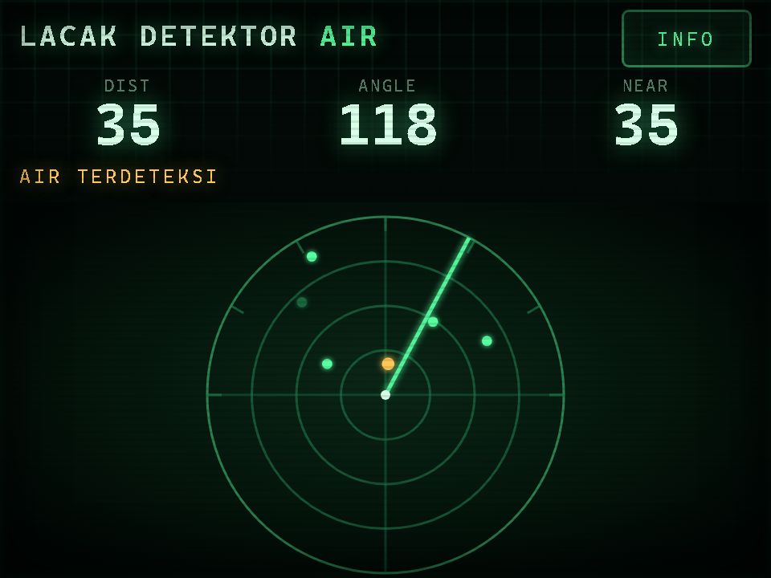
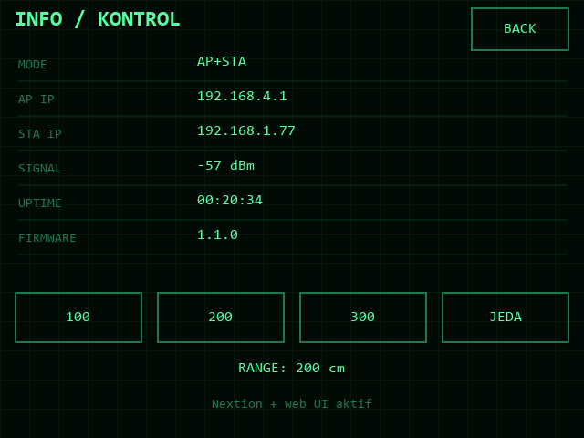
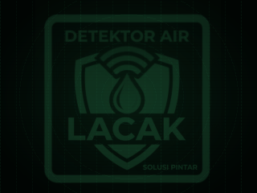

# Nextion UI — NX3224T028 (2.8″ 320×240)

Adds a local touch display to the LACAK DETEKTOR AIR radar **without removing the web
UI**. The ESP32 keeps serving the web app (Config/OTA/radar) and also draws a
simplified radar + info/control pages on the Nextion over UART2.

<p align="center">
  
  
</p>

These are **preview renders**, not screenshots of a flashed display. The
combined device view is [`render/preview.png`](render/preview.png), and the
HTML renderer is [`render/render.html`](render/render.html).

| Welcome (1.5 s) | LACAK (2 s) | Page underlay |
|---|---|---|
|  |  |  |

## Prebuilt HMI (included)

The ready-to-flash screen project is included:

- **`nextion/NX3224T028.tft`** — flash this to the display
- **`nextion/DetektorAir.HMI`** — open this in Nextion Editor (build artifact)
- **`nextion/nx/`** — text source for the same project (nxwright)

> The HMI is a build artifact. If Nextion Editor already has an older copy
> open, close it without saving first; Windows locks the file while it is open.

The TFT was built with **Nextion Editor 1.68.2’s firmware** for the
**NX3224T028**, rotation **90°** (320×240 landscape), baud **115200**.
The compiled app uses **256 + 504 + 36 bytes** of the 3584 bytes of page RAM,
and the TFT is **846,708 bytes** (about 827 KB).

The prebuilt HMI uses **hotspots + text tiles**, not component-ID buttons. Its
hotspots send short serial commands:

```text
NX:INFO   NX:BACK   NX:R100   NX:R200   NX:R300   NX:PAUSE
```

The ESP32 parses them; no “Send Component ID” setup is needed.

### Welcome animation

Page 2 (`welcome`) plays at power-on:

| Time | Image |
|---|---|
| 0.0 s – 1.5 s | `Welcome_screen_1.png` (full logo) |
| 1.5 s – 3.5 s | `Welcome_screen_0.png` (LACAK) |
| 3.5 s onward | page 0 (`radar`) |

At the end it prints `NX:READY`; the ESP32 waits for that before drawing the
radar, so the boot animation is not overwritten. A custom HMI without
`NX:READY` still starts after a **6 s** fallback.

Page 0 and page 1 use **`Page_underlay.png`** (the logo watermark shown under
the UI) as their background picture. The original `Background_underlay.png` is
kept as the source artwork.

### Flash with microSD

1. Format a microSD card as **FAT32**.
2. Copy `NX3224T028.tft` to the card’s root.
3. Power the Nextion off, insert the card, power it on.
4. Wait for the update to finish, remove the card, and power-cycle.

### Flash with Nextion Editor

Open `nextion/DetektorAir.HMI` in Nextion Editor, connect the display with a
USB-TTL adapter, and use the upload function. The TFT can also be sent with
`nxwright upload nextion/NX3224T028.tft COMx`.

### Rebuild the TFT

The text source lives in `nextion/nx`. With nxwright installed:

```bash
nxwright check nextion/nx
nxwright compile nextion/nx nextion/NX3224T028.tft \
  --editor "C:\Program Files (x86)\Nextion Editor"
```

Use `--download` instead of `--editor` to fetch the base firmware from
Nextion’s site.

> The tables below are for a **custom** Nextion Editor build, using component
> IDs. The included prebuilt HMI uses the text-command hotspots described
> above. The ESP32 firmware supports both.

---

## 1. How it works

- The ESP32 talks to the Nextion on **UART2, 115200 baud**.
- Page 0 (`radar`) shows:

  - distance / angle / nearest-contact numbers
  - an amber/green `AIR TERDETEKSI` / `AREA BERSIH` alert
  - a real PPI: range rings, ticks, sweep line and recent contacts, drawn by the
    ESP32 using `fill` / `cir` / `line` / `cirs` primitives

- Page 1 (`info`) shows network status and **range / pause** buttons.
- Page 2 (`welcome`) is the boot animation described above and is not used
  during normal operation.
- The prebuilt HMI reports touches with short text commands (`NX:INFO`, etc.).
  Custom HMIs may also use component IDs. The ESP32 applies range/pause
  changes and broadcasts them to the web UI.
- The Nextion radar is updated at ~5 FPS and the readouts at 4 FPS. This is a
  hardware/serial limit of the Nextion, not the web UI.

The web UI is still the full-featured interface (smooth sweep, history graph,
WiFi config, OTA). The Nextion is a local control head.

---

## 2. Wiring

| Nextion NX3224T028 | ESP32 |
|---|---|
| `5V` | **5 V** supply (not 3.3 V) |
| `GND` | GND (common with ESP32) |
| `TX` | 1 kΩ → **GPIO16 (RX2)**, 2 kΩ from that node to GND |
| `RX` | **GPIO17 (TX2)** (3.3 V logic) |

```text
Nextion TX ──[1 kΩ]──┬──────────── GPIO16  (ESP32 RX2)
                     │
                   [2 kΩ]
                     │
                    GND

Nextion RX ─────────────────────── GPIO17  (ESP32 TX2)
Nextion 5V ─────────────────────── 5 V
Nextion GND ────────────────────── GND (common)
```

- The Nextion serial is **5 V TTL**. The divider drops its TX to ~3.3 V for the
  ESP32. A proper 4-channel level shifter is even safer.
- The ESP32 TX (3.3 V) into the Nextion RX usually works; a level shifter is
  recommended if you want full 5 V levels.
- The display draws roughly 100–150 mA; power it from a 5 V supply that can also
  handle the SG90 (≥1 A) and add a 470–1000 µF capacitor near the display.
- GPIO16/17 are free on a normal ESP32-WROOM. **ESP32-WROVER with PSRAM** may
  reserve GPIO16/17 — use other free pins and edit `NX_RX_PIN` / `NX_TX_PIN` in
  `firmware/ESP32_Radar/nextion_ui.h`.
- Do **not** power the Nextion from 3.3 V.

---

## 3. Nextion Editor project

### 3.1 Pages, baud and fonts

1. New project for **NX3224T028**, 320×240 (landscape), 65k colours.
2. Create two pages **in this order**:
   - page index **0**, name `radar`
   - page index **1**, name `info`

   > The included prebuilt HMI adds a third page at index **2**, `welcome`, for
   > the boot animation. Radar and info stay at 0 and 1 so the firmware’s page
   > constants still match. A custom two-page build can skip the welcome page
   > and start on page 0.

3. In **Program.s** add:

   ```text
   baud=115200
   dim=90
   page 0
   ```

   If your editor does not apply `baud` from Program.s, connect the display at
   9600 once and send `bauds=115200`; power-cycle. The ESP32 firmware expects
   **115200**.
4. Create three fonts (Fonts tab):
   - font 0: ~8 px normal (labels, buttons)
   - font 1: ~20–24 px bold (the three big numbers)
   - font 2: ~12–14 px bold (titles)

   The exact font IDs are not referenced by the firmware — only the component
   values are updated over serial.

5. Background colour: **black** (`0`). No components inside the radar area
   (page 0, y = 84 to 239); the ESP32 clears that area with `fill`.

### 3.2 Page 0 — `radar`

| Type | Name | X | Y | W | H | Text / setting |
|---|---|---|---|---|---|---|
| Text | `tTitle` | 8 | 0 | 244 | 24 | `LACAK DETEKTOR AIR`, font 2 (Sans20), green |
| Button | `bInfo` | 258 | 4 | 54 | 24 | `INFO`, font 0, **ID 1**, Send Component ID on release |
| Text | `tDistLbl` | 8 | 30 | 90 | 12 | `DIST`, font 0, dim green |
| Text | `tAngleLbl` | 116 | 30 | 90 | 12 | `ANGLE`, font 0, dim green |
| Text | `tNearLbl` | 224 | 30 | 88 | 12 | `NEAR`, font 0, dim green |
| Number | `nDist` | 8 | 40 | 90 | 24 | font 1, green, length 3 |
| Number | `nAngle` | 116 | 40 | 90 | 24 | font 1, green, length 3 |
| Number | `nNear` | 224 | 40 | 88 | 24 | font 1, green, length 3 |
| Text | `tAlert` | 8 | 66 | 304 | 16 | `AREA BERSIH`, font 0, green on black, `txt_maxl` ≥ 24 |

- **Do not put any component in x 0…319, y 84…239.** The firmware draws the
  radar there and the `fill` clears the area.
- The three Number components are written as `nDist.val=...` etc.
- `tAlert.pco` and `tAlert.txt` are updated when a contact enters the 50 cm
  alert range.
- The alert threshold is `NX_ALERT_CM` in `nextion_ui.h` (default 50 cm). It is
  separate from the web UI's threshold slider.

### 3.3 Page 1 — `info`

| Type | Name | X | Y | W | H | Text / setting |
|---|---|---|---|---|---|---|
| Text | `tTitle2` | 8 | 4 | 220 | 22 | `INFO / KONTROL`, font 2, green |
| Button | `bBack` | 258 | 4 | 54 | 24 | `BACK`, font 0, **ID 1**, Send Component ID on release |
| Text | `tModeLbl` | 10 | 32 | 90 | 14 | `MODE`, font 0, dim |
| Text | `tMode` | 108 | 30 | 202 | 16 | value, font 0, green, `txt_maxl` 10 |
| Text | `tApLbl` | 10 | 51 | 90 | 14 | `AP IP` |
| Text | `tApIp` | 108 | 49 | 202 | 16 | value, `txt_maxl` 16 |
| Text | `tStaLbl` | 10 | 70 | 90 | 14 | `STA IP` |
| Text | `tStaIp` | 108 | 68 | 202 | 16 | value, `txt_maxl` 16 |
| Text | `tRssiLbl` | 10 | 89 | 90 | 14 | `SIGNAL` |
| Text | `tRssi` | 108 | 87 | 202 | 16 | value, `txt_maxl` 12 |
| Text | `tUpLbl` | 10 | 108 | 90 | 14 | `UPTIME` |
| Text | `tUp` | 108 | 106 | 202 | 16 | value, `txt_maxl` 10 |
| Text | `tFwLbl` | 10 | 127 | 90 | 14 | `FIRMWARE` |
| Text | `tFw` | 108 | 125 | 202 | 16 | value, `txt_maxl` 10 |
| Button | `bR100` | 8 | 160 | 70 | 28 | `100`, **ID 2** |
| Button | `bR200` | 86 | 160 | 70 | 28 | `200`, **ID 3** |
| Button | `bR300` | 164 | 160 | 70 | 28 | `300`, **ID 4** |
| Button | `tPauseBtn` | 242 | 160 | 70 | 28 | `JEDA`, **ID 5** |
| Text | `tRange` | 8 | 196 | 304 | 16 | `200 cm`, font 0, green, centered, `txt_maxl` 12 |
| Text | `tNote` | 8 | 218 | 304 | 16 | `Nextion + web UI aktif`, font 0, dim, `txt_maxl` 32 |

- The four buttons must have **Send Component ID** enabled on the **Touch
  Release Event**. Do not add a local `page` action; the ESP32 controls pages.
- The firmware changes `tPauseBtn.txt` to `JEDA` / `LANJUT` and updates `tRange`.
- Values are written by the ESP32; the labels are static.

### 3.4 Touch component IDs

The ESP32 reacts to these IDs (defined in `nextion_ui.h`):

| Page | Button | Expected ID |
|---|---|---|
| 0 | `bInfo` | 1 |
| 1 | `bBack` | 1 |
| 1 | `bR100` | 2 |
| 1 | `bR200` | 3 |
| 1 | `bR300` | 4 |
| 1 | `tPauseBtn` | 5 |

The editor may assign different IDs depending on the order you create
components. Verify them:

1. Flash the HMI and open the ESP32 **Serial Monitor at 115200**.
2. Touch each button.
3. The firmware prints:

   ```text
   [NX] touch page=0 comp=1 event=0
   [NX] touch page=1 comp=2 event=0
   ...
   ```

   `event=0` is release, `event=1` is press. The firmware debounces both.
4. If the `comp` values differ, either create the buttons first on each page or
   edit `NX_ID_*` at the top of `firmware/ESP32_Radar/nextion_ui.h`.

> The Info/Back buttons share ID 1 because they are on different pages.

### 3.5 Compile and upload

- **Compile** the project in Nextion Editor. It produces a `.tft` file.
- Upload it with Nextion Editor's upload function (USB-TTL), or copy the `.tft`
  to a FAT32 microSD card, power-cycle the display and follow the Nextion
  upgrade procedure. Remove the card and power-cycle again.
- The display must run at **115200 baud** after the update.

---

## 4. ESP32 firmware

`firmware/ESP32_Radar/nextion_ui.h` contains the driver. The main sketch already
includes it:

```cpp
#define NEXTION_ENABLED 1
#include "nextion_ui.h"
```

Change the following in `nextion_ui.h` if needed:

```cpp
#define NX_RX_PIN 16
#define NX_TX_PIN 17
#define NX_BAUD   115200
#define NX_ALERT_CM 50
```

- Set `NEXTION_ENABLED 0` in `ESP32_Radar.ino` if the display is not connected.
- The ESP32 starts the Nextion after the web server/OTA setup, waits 1.2 s for
  the display to boot, then waits for the welcome page’s `NX:READY` (or a 6 s
  fallback) before drawing the radar.
- The Nextion range/pause buttons call the same firmware state as the web UI;
  the web UI receives a `cfg` broadcast and stays in sync.
- The radar page is drawn for the last 12 contacts in an ~8 s window.
- Both UIs can be used at the same time.
- The Nextion `JEDA` button toggles pause/stop in both AUTO and HAND modes.
  AUTO/HAND selection, the manual angle and the buzzer are currently web-only;
  they can be added to the HMI later.

---

## 5. Testing

Normal serial output after boot:

```text
[NX] Nextion UART started: 115200 baud, RX=16 TX=17 (waiting for welcome)
...
[NX] cmd NX:READY
[NX] Welcome finished, radar page active
...
[NX] cmd NX:INFO
[NX] cmd NX:R200
```

Custom component-ID HMIs additionally print `[NX] touch page=... comp=...`.
A custom HMI that never sends `NX:READY` logs
`[NX] Welcome timeout, forcing radar page` after 6 s.

- The welcome animation should play for about 3.5 s, then page 0 shows the
  radar and numbers.
- Press INFO → page 1. Press 100/200/300 → the radar range changes and the web
  UI range slider follows. Press JEDA → the sweep pauses; the web UI shows
  “JEDA”.
- Press BACK → the radar returns.

If you see values but no radar, check the radar area is empty in the HMI (the
`fill` may be covering components).

---

## 6. Troubleshooting

| Symptom | Check |
|---|---|
| Display white/blank | 5 V power, common ground, HMI flashed, baud 115200. |
| Welcome animation skipped | The TFT is old or `program.nx` still says `page radar`; rebuild and flash the new TFT. |
| Radar appears after ~6 s instead of 3.5 s | The welcome page’s `NX:READY` did not reach the ESP32 (Nextion TX/divider, firmware without the new parser); the fallback forces page 0. |
| Underlay not visible | It sits behind the text tiles’ opaque backgrounds; it shows only in the gaps. Check the `pUnderlay` picture is present on pages 0 and 1. |
| No text updates | Baud mismatch (9600 vs 115200), wrong object names, page 0 not loaded, `txt_maxl` too small. |
| Touch does nothing (prebuilt HMI) | Baud 115200, HMI flashed, Nextion TX divider, and check for `[NX] cmd ...` in the serial log. |
| Touch does nothing (custom HMI) | **Send Component ID** not checked; wrong component ID; TX/RX swapped; level divider. |
| Buttons work but page doesn’t change | Prebuilt: the page code’s `page` line; custom: the button must send its ID. |
| Radar draws over the Info page | Prebuilt: the hotspot `prints`/`page` code must run. Custom: ensure page switches are reported to the firmware. |
| ESP32 reboots when display connected | 5 V supply too weak; add capacitor; common ground; level shifter. |
| Garbled Nextion screen | Baud mismatch or bad ground; set both sides to 115200. |
| Touch IDs don’t match the table (custom HMI) | Read the `[NX] touch ...` log and edit `NX_ID_*`. The prebuilt HMI does not use component IDs. |
| Updates are slow | Nextion drawing/serial limit; keep the 2.8″ Basic at 115200, expect ~5 FPS radar. |
| Web UI still works without Nextion | Yes — set `NEXTION_ENABLED 0` to disable UART2 if unused. |

---

## 7. Limitations

- The Nextion Basic is not a fast graphics display; the local radar is a
  simplified 5 FPS PPI, not the smooth 60 FPS web canvas.
- The Nextion alert threshold is fixed at 50 cm (`NX_ALERT_CM`); the web UI has
  its own adjustable threshold.
- Only the last 12 contacts are drawn, over an ~8 s window.
- The 2.8″ 320×240 layout above is tight; keep the component coordinates and
  avoid adding widgets inside the radar area.
- The Nextion is an **additional** interface; WiFi, Config and OTA remain in the
  web UI.
