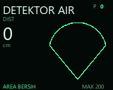
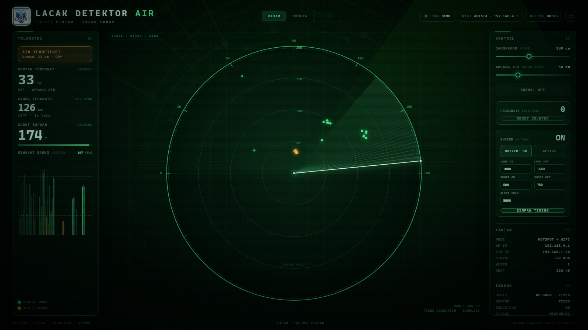
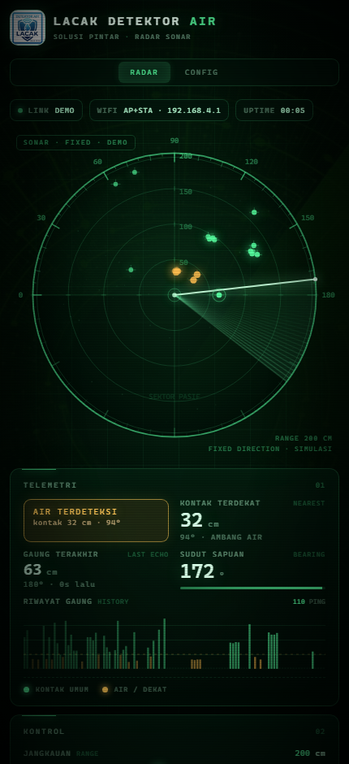

# v2.0.1 — ST7735 + HC-SR04 + inductive counter + buzzer

Branch: `v2.0.1` (based on the final v2.0 branch)

This is the v2.0 fixed-direction build with the **MAX98357A I2S audio replaced
by a GPIO23 buzzer**. There is no MP3/WAV playback and no ESP8266Audio
dependency.

## Download & flash

Prebuilt **v2.0.1 ST7735** firmware (`FW_VERSION 2.0.1`):

| File | Use |
|---|---|
| [`../bin/v2.0.1/DetektorAir-v2.0.1-ST7735-factory.bin`](../bin/v2.0.1/DetektorAir-v2.0.1-ST7735-factory.bin) | blank / new board, flash at **0x0** |
| [`../bin/v2.0.1/DetektorAir-v2.0.1-ST7735-ota.bin`](../bin/v2.0.1/DetektorAir-v2.0.1-ST7735-ota.bin) | web **CONFIG → UPDATE FIRMWARE** or ArduinoOTA |

Blank board over USB (from the repository root):

```cmd
esptool.py --chip esp32 --port COM5 write_flash 0x0 bin\v2.0.1\DetektorAir-v2.0.1-ST7735-factory.bin
```

Checksums: [`../bin/v2.0.1/SHA256SUMS.txt`](../bin/v2.0.1/SHA256SUMS.txt).

## Renders

| ST7735 boot | ST7735 idle | ST7735 detected |
|---|---|---|
|  |  |  |





## Hardware

| Function | ESP32 pin | Notes |
|---|---|---|
| HC-SR04 `TRIG` | GPIO 5 | 10 µs trigger |
| HC-SR04 `ECHO` | GPIO 18 | 1 kΩ / 2 kΩ divider to 3.3 V |
| ST7735 `SCLK` | GPIO 14 | |
| ST7735 `MOSI` | GPIO 13 | |
| ST7735 `CS` | GPIO 27 | |
| ST7735 `DC` | GPIO 26 | |
| ST7735 `RST` | GPIO 25 | |
| ST7735 `BL` | GPIO 32 | |
| **Buzzer `+`** | **GPIO 23** | active or passive |
| Buzzer `−` | GND | |
| Inductive sensor output | GPIO 34 | 1 kΩ series + 10 kΩ pull-up to 3.3 V |
| Inductive sensor supply | 6–36 V | common GND |
| Reset button | GPIO 33 | button to GND, internal pull-up |

There is no servo. The HC-SR04 measures continuously in one fixed direction.
GPIO 19/21/22 are now free; they were the MAX98357A I2S pins in v2.0.

### Buzzer wiring

```text
Active buzzer:   + -> GPIO 23,  - -> GND
Passive buzzer:  + -> GPIO 23,  - -> GND
```

- The firmware supports both types; select **ACTIVE** or **PASSIVE** in the web
  UI.
- Active: GPIO HIGH = sound.
- Passive: 2200 Hz tone on GPIO 23.
- A small 3.3 V buzzer can be driven directly. If the buzzer draws more than
  about 12 mA, use an NPN transistor (1 kΩ base resistor) or a small N-channel
  MOSFET.
- Never connect a 5 V buzzer directly to GPIO 23.

## Buzzer behaviour

At boot, after WiFi/AP and the HC-SR04 start:

| State | Pattern | Default |
|---|---|---|
| Idle | long ON / long OFF | **1000 ms / 1500 ms** |
| Proximity pulse | short ON / short OFF | **500 ms / 750 ms** |
| Alert hold | short pattern duration after a pulse | **5000 ms** |

- Each new inductive detection increments the counter, saves it in NVS, and
  restarts the short alert pattern.
- After the alert hold expires, the long idle pattern resumes.
- All timings are adjustable in the web UI and stored in NVS.
- The buzzer can be enabled/disabled from the web UI.
- The counter can still be reset by GPIO33, the web UI, or the existing
  **RESET COUNTER** button.

## Web UI

The **CONTROL** panel now includes a **BUZZER PATTERN** card:

- **BUZZER: ON/OFF**
- **ACTIVE / PASSIVE**
- LONG ON, LONG OFF, SHORT ON, SHORT OFF, ALERT HOLD (ms)
- **SIMPAN TIMING** saves all five values to the ESP32

The web UI also retains the sonar scope, telemetry, proximity counter, config
and OTA pages.

## Build

```bash
pio run -e esp32dev
```

PlatformIO result: **1,182,189 bytes (60.1%) flash**, **51,440 bytes (15.7%)
RAM**.

ESP8266Audio and the embedded MP3/WAV arrays are no longer linked, so the
firmware is smaller than v2.0.

## Firmware images

```text
bin/v2.0.1/DetektorAir-v2.0.1-ST7735-factory.bin   flash at 0x0 (blank board)
bin/v2.0.1/DetektorAir-v2.0.1-ST7735-ota.bin       web OTA / ArduinoOTA
```

See [`../bin/README.md`](../bin/README.md) for all versions.

## Notes

- The ST7735 is the same 1.8" 128×160 SPI, no-touch module used in v2.0.
- If the display is blank or offset, use the v2.0 ST7735S `REDTAB` /
  `GREENTAB` OTA variants from `bin/v2.0/variants/` (the display code is the
  same).
- The buzzer timing values are clamped to 50–60000 ms; alert hold is
  0–600000 ms.
- OTA leaves the NVS counter, buzzer timings and WiFi settings intact.
