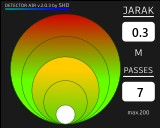
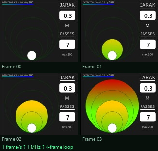

# v2.0.3 — WiFi AP+STA + Bluetooth SPP hybrid

Branch: `v2.0.3` (based on v2.0.1)

This is the hybrid build:

- v2.0.1 WiFi **AP + STA**
- embedded web UI at `http://192.168.4.1`
- web OTA and ArduinoOTA
- **Bluetooth Classic SPP** for the Android APK
- ST7735 animated radar, buzzer, inductive pass counter, meters

The ESP32 shares one 2.4 GHz radio between WiFi and Bluetooth. Both can run at
the same time, but heavy WiFi traffic can reduce Bluetooth responsiveness and
vice versa.

## Renders

| Welcome (3 s) | Scan artwork + live values | Animation sequence |
|---|---|---|
|  |  |  |

## Download

| File | Use |
|---|---|
| [`../bin/v2.0.3/DetektorAir-v2.0.3-ST7735-WiFi-BT-factory.bin`](../bin/v2.0.3/DetektorAir-v2.0.3-ST7735-WiFi-BT-factory.bin) | blank / new board, flash at **0x0** |
| [`../bin/v2.0.3/DetektorAir-v2.0.3-ST7735-WiFi-BT-ota.bin`](../bin/v2.0.3/DetektorAir-v2.0.3-ST7735-WiFi-BT-ota.bin) | web OTA from v2.0.1/v2.0.3 |
| [`../bin/v2.0.3/DetektorAir-Bluetooth-v2.0.3.apk`](../bin/v2.0.3/DetektorAir-Bluetooth-v2.0.3.apk) | Android Bluetooth app |
| [`../bin/v2.0.3/DetektorAir-Bluetooth-v2.0.3b.apk`](../bin/v2.0.3/DetektorAir-Bluetooth-v2.0.3b.apk) | APK with secure → insecure → RFCOMM channel 1 fallback |
| [`../bin/v2.0.3/DetektorAir-Bluetooth-v2.0.3c.apk`](../bin/v2.0.3/DetektorAir-Bluetooth-v2.0.3c.apk) | Same fallback + scrollable device picker |

```cmd
esptool.py --chip esp32 --port COM5 write_flash 0x0 bin\v2.0.3\DetektorAir-v2.0.3-ST7735-WiFi-BT-factory.bin
```

Checksums: [`../bin/v2.0.3/SHA256SUMS.txt`](../bin/v2.0.3/SHA256SUMS.txt).

## Connect

### Web UI over WiFi

```text
SSID: DetektorAir
Pass: radar12345
URL : http://192.168.4.1
```

The existing CONFIG tab, network settings, OTA and buzzer controls are
available.

### Android APK over Bluetooth

```text
Name: DetektorAir
Type: Bluetooth Classic SPP
PIN : 1234
```

1. Pair **DetektorAir** (PIN 1234) in Android Bluetooth settings.
2. Install `DetektorAir-Bluetooth-v2.0.3.apk`.
3. Select **DetektorAir** and tap **HUBUNGKAN**.
4. Press **Back** in the radar to disconnect.

Both can be used at the same time: the web UI can stay open while the phone
uses Bluetooth.

## Display artwork

- **WelcomeScreen.jpg** is shown for **3 seconds** after the display initializes.
- Then **RadarScan_00 → 01 → 02 → 03 → 00** loops continuously:
  - **1 frame per second**
  - **1 MHz SPI**
  - 4-frame cycle takes about 4 seconds
- The distance and pass count are drawn in **FreeSansBold (modern sans)**
  inside the white boxes of the artwork.
- The animation uses the same four JPEGs already stored in flash; there are no
  extra image assets.

The previous distance-based background mapping is still available by setting:

```cpp
#define SCAN_ANIMATE 0
```

| Frame | Distance-based condition |
|---|---|
| `RadarScan_00` | no echo / idle |
| `RadarScan_01` | object farther than the alert threshold |
| `RadarScan_02` | object inside the alert threshold |
| `RadarScan_03` | object very close (half the alert threshold) |

## Build result

```text
Firmware: 1,909,769 bytes (97.1%) flash
RAM:         68,712 bytes (21.0%)
APK:        327,707 bytes, version 2.0.3
```

> Flash usage is **97.1%** of the 1.875 MB OTA slot. It fits, but there is only
> about 56 KB headroom. Avoid adding large new assets to this build.

## Protocol

Bluetooth and WebSocket use the same JSON telemetry:

```json
{"a":91,"d":33,"mx":200,"pc":7}
```

Config on connect/change:

```json
{"cfg":1,"mx":200,"thr":50,"pc":7,"bz":1,"ba":1,"b0":1000,"b1":1500,"b2":500,"b3":750,"b4":5000}
```

Commands: `C0`, `B1/B0`, `Y1/Y0`, `Zlo,lf,so,sf,hold`, `R<cm>`, `T<cm>`.

## Notes

- WiFi + Bluetooth Classic coexistence is supported by the ESP32 radio, but
  not independently. Test under your actual load.
- The APK is debug-signed; allow “install unknown apps”.
- OTA remains available in the web UI.
- The Android APK hides the WiFi/CONFIG tab in its local WebView; use a browser
  for WiFi/OTA configuration.
