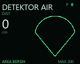
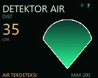
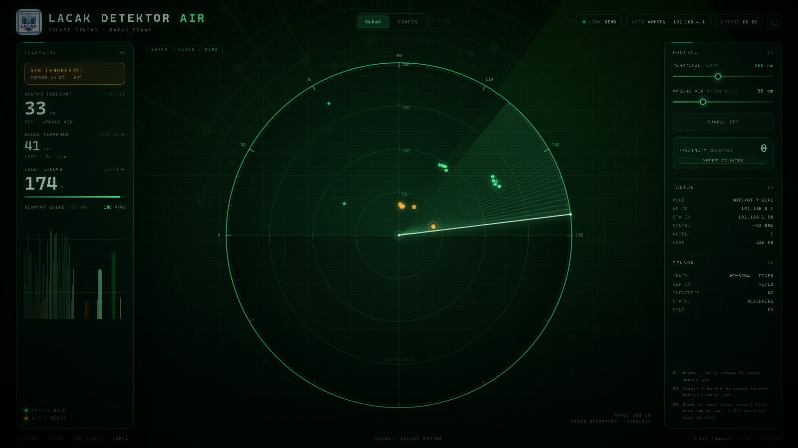
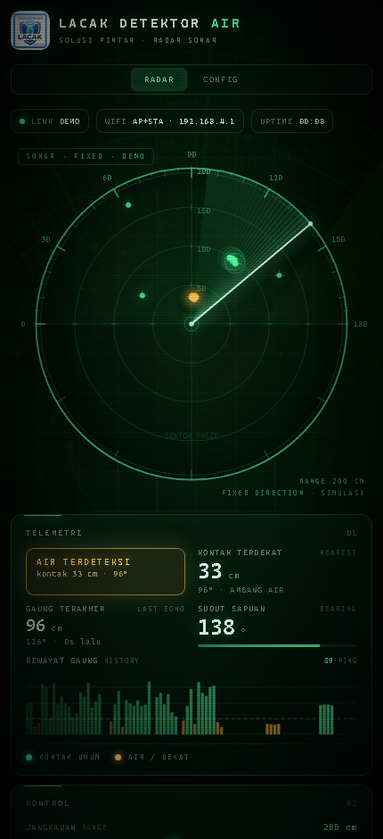

# v2.0 — HC-SR04 + ST7735 + MAX98357A + inductive proximity

Branch: `v2.0` (based on the ST7735 display branch)

## Download & flash

Prebuilt **v2.0 ST7735** firmware (`FW_VERSION 2.0.0`):

| File | Use |
|---|---|
| [`bin/DetektorAir-v2.0-ST7735-factory.bin`](bin/DetektorAir-v2.0-ST7735-factory.bin) | new / blank board, flash at **0x0** |
| [`bin/DetektorAir-v2.0-ST7735-ota.bin`](bin/DetektorAir-v2.0-ST7735-ota.bin) | web **CONFIG → UPDATE FIRMWARE** or ArduinoOTA |

Blank board over USB:

```cmd
esptool.py --chip esp32 --port COM5 write_flash 0x0 bin\DetektorAir-v2.0-ST7735-factory.bin
```

Existing v2.0 board: upload `bin/DetektorAir-v2.0-ST7735-ota.bin` from the web
CONFIG tab (or use ArduinoOTA on port 3232, password `lacakota`).

Checksums: [`bin/SHA256SUMS.txt`](bin/SHA256SUMS.txt).

> The older root files `DetektorAir-ST7735-factory.bin` and
> `DetektorAir-ST7735-ota.bin` are from the **servo sweep** ST7735 branch.
> Do not use them for v2.0.

## Renders

| ST7735 boot | ST7735 idle | ST7735 detected |
|---|---|---|
|  |  |  |





## Hardware

| Function | ESP32 pin | Notes |
|---|---|---|
| HC-SR04 TRIG | GPIO 5 | 10 µs trigger |
| HC-SR04 ECHO | GPIO 18 | 1 kΩ / 2 kΩ divider to 3.3 V |
| ST7735 SCLK | GPIO 14 | 3.3 V logic |
| ST7735 MOSI | GPIO 13 | |
| ST7735 CS | GPIO 27 | |
| ST7735 DC | GPIO 26 | |
| ST7735 RST | GPIO 25 | |
| ST7735 BL | GPIO 32 | |
| MAX98357A BCLK | GPIO 19 | servo pin is free in v2.0 |
| MAX98357A LRC | GPIO 21 | |
| MAX98357A DIN | GPIO 22 | |
| MAX98357A VIN | 5 V | speaker amp supply |
| MAX98357A GND | GND | common ground |
| Inductive sensor output | GPIO 34 | NPN open collector, 10 kΩ pull-up to 3.3 V, 1 kΩ series |
| Inductive sensor supply | 6–36 V sensor rating | common GND required |
| Physical reset button | GPIO 33 | button to GND, internal pull-up |

No servo is used. The HC-SR04 measures continuously in one fixed direction.

### NPN inductive sensor

Typical LJ12A3-4-Z/BX:

```text
brown  → sensor supply + (6–36 V)
blue   → GND (common with ESP32)
black  → GPIO 34
         10 kΩ from GPIO 34 to 3.3 V
         1 kΩ in series with the black wire
```

The sensor pulls the output low when metal is detected. ESP32 GPIO34 is
input-only and needs the external pull-up.

## Behaviour

- HC-SR04 measures continuously in one fixed direction.
- ST7735 shows the boot logo for 1.5 s, then distance and proximity count.
- The provided droplet artwork is an outline normally and fills with a green
  gradient when a contact is inside the alert threshold.
- Each new inductive detection increments and saves the counter in NVS.
- Reset the counter with the **physical button on GPIO33** or the
  **RESET COUNTER** button in the web UI.
- Each detection plays the embedded **MP3** alert through the MAX98357A.
  A WAV version is embedded too; switch with `PROX_AUDIO_USE_MP3`.
- Web UI and OTA remain available.
- Web background uses `web/bg.jpg`; the header logo remains `web/logo.jpg`.

## Audio files

```text
firmware/ESP32_Radar/audio_prox.h   embedded MP3 + WAV arrays
firmware/ESP32_Radar/prox_alert.mp3 reference MP3
firmware/ESP32_Radar/prox_alert.wav reference WAV
```

ESP8266Audio is GPL-3.0; the firmware/source must be distributed together.

## Build result

- PlatformIO: **1,274,177 bytes (64.8%)**, RAM **51,336 (15.7%)**
- Arduino: **1,460,491 bytes (74%)**, RAM **54,136 (16%)**
- Arduino IDE needs TFT_eSPI and ESP8266Audio 1.9.9 installed.
