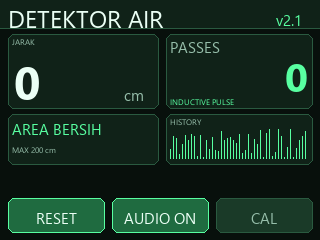
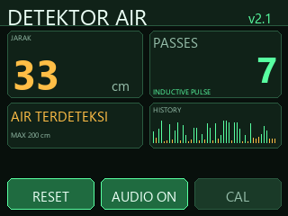
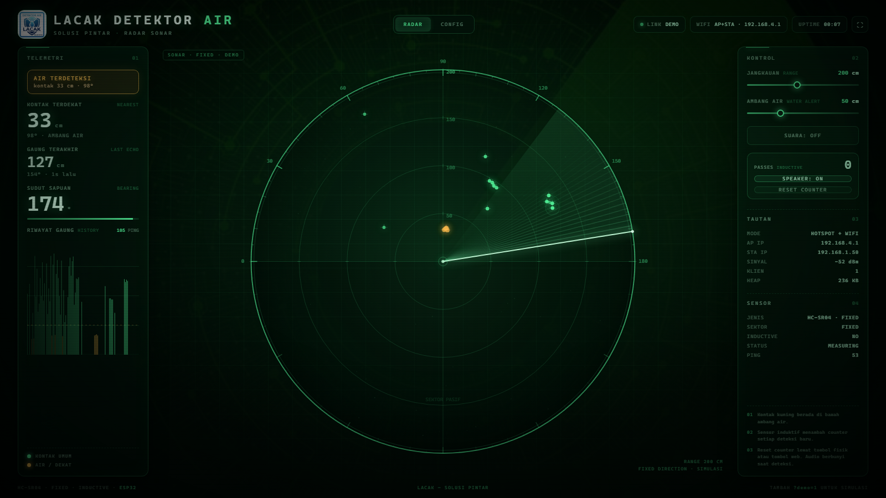
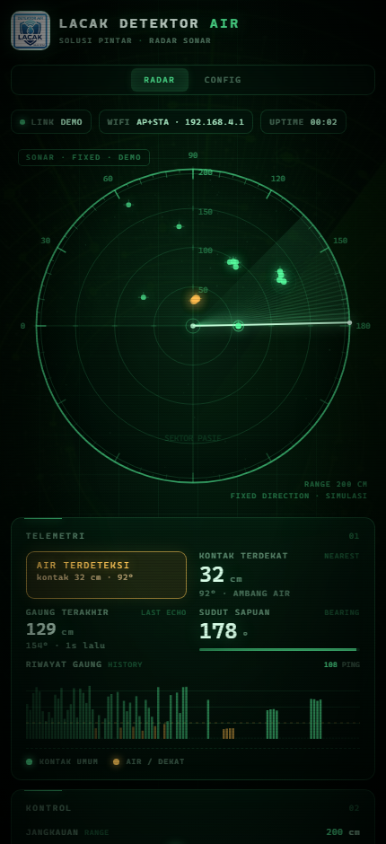

# v2.1 — ILI9341 2.4" touch + rotating sonar + inductive pass counter

Branch: `v2.1` (based on the final v2.0 branch)

## Download & flash

Prebuilt **v2.1 ILI9341** firmware (`FW_VERSION 2.1.0`):

| File | Use |
|---|---|
| [`../bin/v2.1/DetektorAir-v2.1-ILI9341-factory.bin`](../bin/v2.1/DetektorAir-v2.1-ILI9341-factory.bin) | new / blank board, flash at **0x0** |
| [`../bin/v2.1/DetektorAir-v2.1-ILI9341-ota.bin`](../bin/v2.1/DetektorAir-v2.1-ILI9341-ota.bin) | web **CONFIG → UPDATE FIRMWARE** or ArduinoOTA |

Blank board over USB (from the repository root):

```cmd
esptool.py --chip esp32 --port COM5 write_flash 0x0 bin\v2.1\DetektorAir-v2.1-ILI9341-factory.bin
```

Existing v2.1 board: upload `bin/v2.1/DetektorAir-v2.1-ILI9341-ota.bin` from the
web CONFIG tab, or use ArduinoOTA on port 3232 with password `lacakota`.

Checksums: [`../bin/v2.1/SHA256SUMS.txt`](../bin/v2.1/SHA256SUMS.txt).

## Renders

| Idle | Object detected |
|---|---|
|  |  |





## Hardware

| Function | ESP32 pin | Notes |
|---|---|---|
| HC-SR04 `TRIG` | GPIO 5 | 10 µs trigger |
| HC-SR04 `ECHO` | GPIO 18 | 1 kΩ / 2 kΩ divider to 3.3 V |
| ILI9341 `SCLK` | GPIO 14 | shared with touch |
| ILI9341 `MOSI` | GPIO 13 | shared with touch |
| ILI9341 `MISO` | GPIO 17 | shared with touch |
| ILI9341 `CS` | GPIO 27 | |
| ILI9341 `DC` | GPIO 26 | |
| ILI9341 `RST` | GPIO 25 | |
| ILI9341 `BL` | GPIO 32 | drive through transistor/MOSFET |
| Touch `T_CLK` | GPIO 14 | XPT2046 |
| Touch `T_DIN` | GPIO 13 | |
| Touch `T_DO` | GPIO 17 | |
| Touch `T_CS` | GPIO 16 | |
| Touch `T_IRQ` | not used | polled by TFT_eSPI |
| MAX98357A `BCLK` | GPIO 19 | |
| MAX98357A `LRC` | GPIO 21 | |
| MAX98357A `DIN` | GPIO 22 | |
| Inductive sensor | GPIO 34 | 1 kΩ series + 10 kΩ pull-up to 3.3 V |
| Reset button | GPIO 33 | button to GND, internal pull-up |

There is **no servo and no motor**. The ESP32, display and HC-SR04 are mounted
on a bearing-mounted unit that turns freely. The HC-SR04 measures continuously
in the direction the unit faces.

GPIO 23 is free. GPIO 16/17 are safe on ESP32-WROOM; on WROVER they are used
for PSRAM.

## Behaviour

- 2.4" ILI9341 in **320×240 landscape**.
- HC-SR04 distance, status, pass counter and history on the TFT.
- Inductive sensor counts each metal pass on the rotating handle.
- Each pass:
  - increments the counter,
  - saves it in NVS,
  - plays the embedded MP3 (or WAV) through the MAX98357A.
- Counter reset:
  - physical button on GPIO33,
  - web UI **RESET COUNTER**,
  - touch button **RESET**.
- Touch buttons on the TFT:
  - **RESET** — clear the pass counter,
  - **AUDIO ON/OFF** — mute/unmute the local MAX98357A,
  - **CAL** — recalibrate the touchscreen.
- Web UI keeps the sonar display, telemetry, config and OTA.
- OTA: web CONFIG tab and ArduinoOTA port 3232, password `lacakota`.

## Touchscreen

The XPT2046 touch panel is used for the three large buttons only; there is no
full configuration page on the TFT. Network/OTA configuration stays in the web
UI.

On first boot the display asks for a touch calibration. Touch the crosshair
points when prompted. The calibration is stored in NVS (`lacak` namespace).
If it is skipped, the **CAL** button re-runs calibration.

## Build

```bash
pio run -e esp32dev
```

PlatformIO result: **1,216,409 bytes (61.9%) flash**, **51,456 bytes (15.7%)
RAM**.

Arduino IDE:

1. Install TFT_eSPI `2.5.43` and ESP8266Audio `1.9.9`.
2. Replace the TFT_eSPI library's `User_Setup.h` with
   [`TFT_eSPI_User_Setup.h`](TFT_eSPI_User_Setup.h).
3. Select **ESP32 Dev Module** and
   **Minimal SPIFFS (1.9MB APP with OTA)**.
4. Compile.

Arduino result: **1,392,591 bytes (70%) flash**, **54,256 bytes (16%) RAM**.

## Firmware images

```text
bin/v2.1/DetektorAir-v2.1-ILI9341-factory.bin   flash at 0x0 (blank board)
bin/v2.1/DetektorAir-v2.1-ILI9341-ota.bin       web OTA / ArduinoOTA
```

See [`../bin/README.md`](../bin/README.md) for all versions.

## Notes

- The board can be a 30-pin or 38-pin ESP32-WROOM-32. GPIO 16/17 are safe on
  WROOM but are used for PSRAM on WROVER.
- The 2.4" backlight draws more current than a GPIO can source. Use a
  transistor/MOSFET on GPIO 32, or tie `BL` to 3.3 V. If the backlight is
  active-low, set `TFT_BACKLIGHT_ON` to `LOW`.
- If the display colours are swapped, change `TFT_RGB_ORDER` between
  `TFT_BGR` and `TFT_RGB` in `platformio.ini` and `ili9341_ui.h`.
- If the image is rotated, change `DISPLAY_ROTATION` (1 or 3).
- If the metal target passes quickly, the inductive debounce can be lowered in
  `proximity.h` (currently 80 ms).
- The web UI keeps the sonar display at a fixed bearing; there is no angle
  sensor on the freely rotating unit.
- The whole electronics stack rotates. Route 5 V/GND (and the inductive sensor
  supply) through a slip ring, or use a battery on the rotating part. Leave a
  service loop so the cables cannot twist and break.
- The ILI9341 module's microSD slot and `T_IRQ` are not used; leave them
  unconnected.
